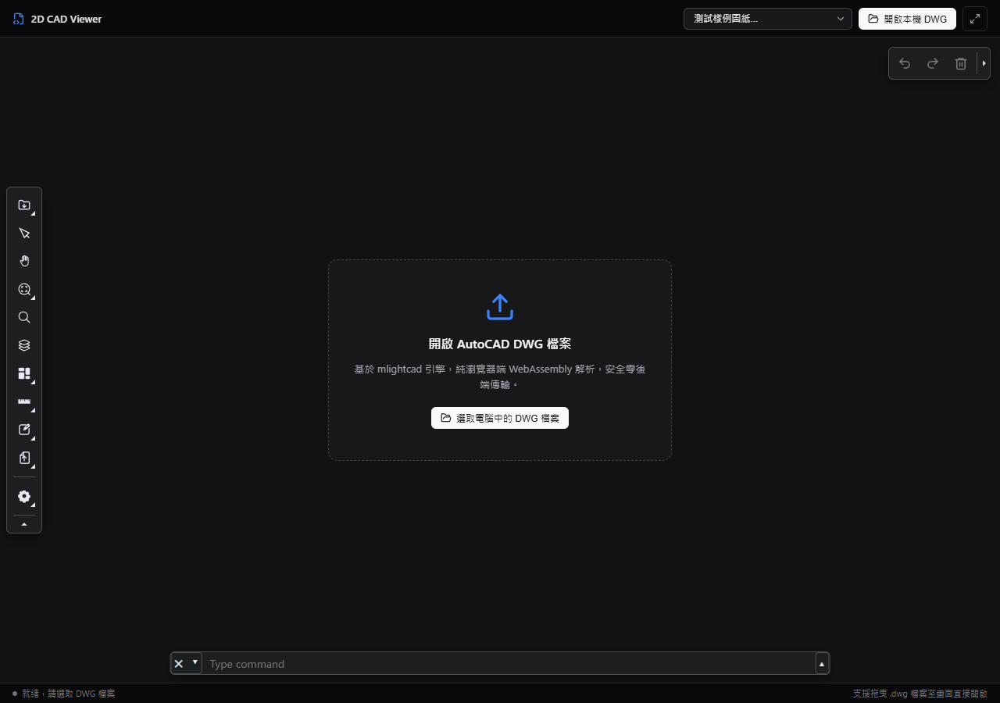
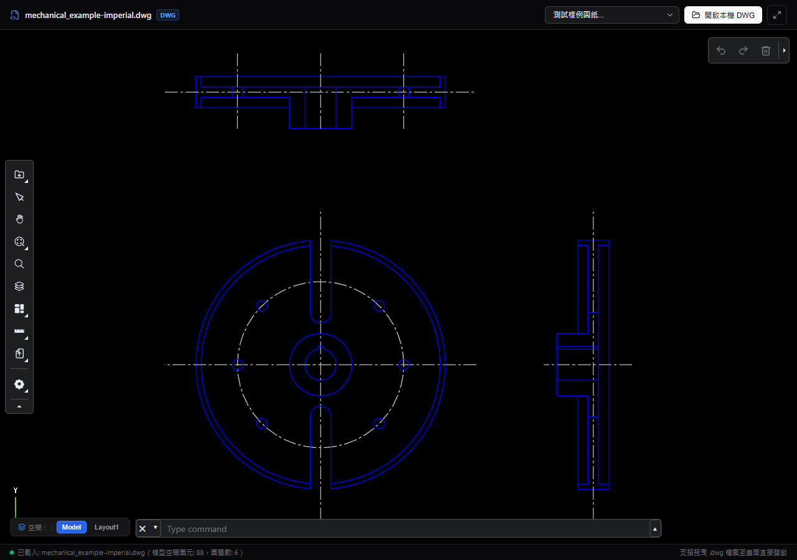
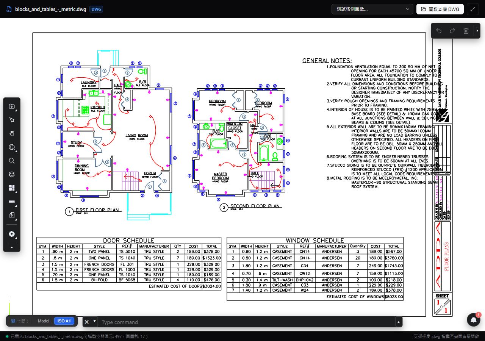
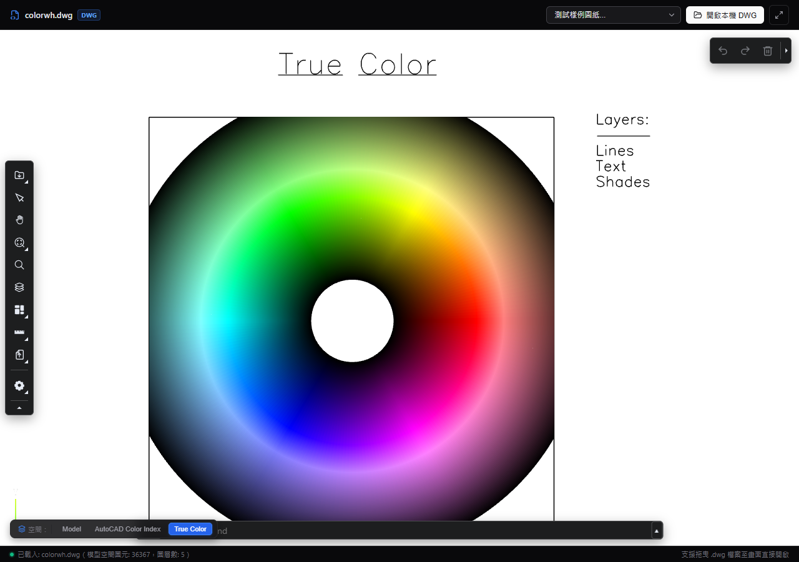
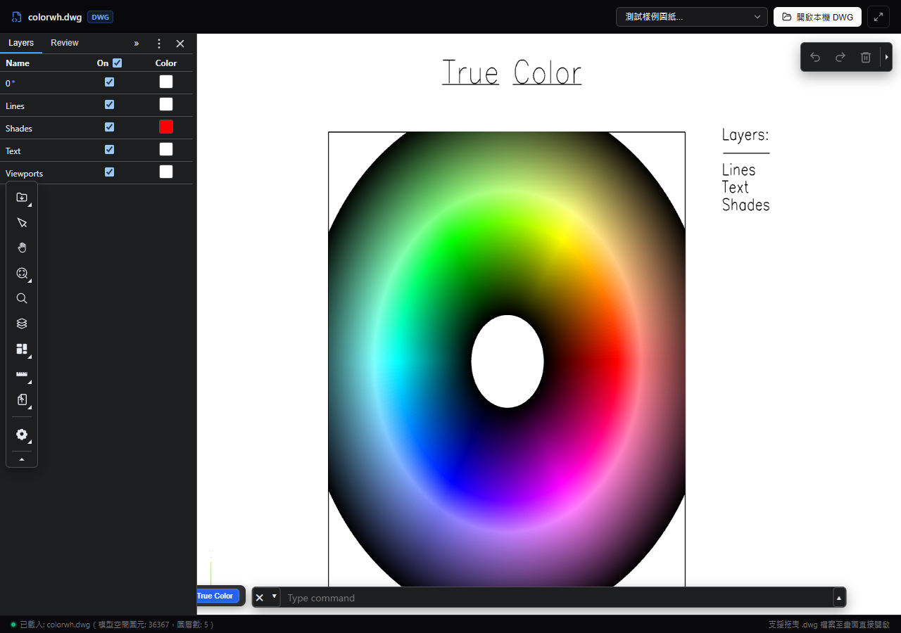

# 2D CAD 圖紙檢視器 (2D CAD Viewer)

基於 **React + TypeScript + Vite** 與 **mlightcad 核心引擎** 建構的現代化 Web 端 CAD 圖紙檢視器。採用純前端 WebAssembly（LibreDWG）進行本地二進位 DWG/DXF 解析與 Three.js 渲染，無須架設任何後端轉檔服務，資料不離開使用者瀏覽器，兼具極致安全性與高效能。

---

## 📸 功能展示與截圖說明

### 1. 極簡暗色介面與空狀態
採用 **shadcn/ui** 設計風格，提供極簡暗色調介面、流暢的拖放區域（Drag & Drop）以及本地 DWG 檔案選取功能。


---

### 2. 工程機械圖面呈現 (Mechanical Sample)
完美解析複雜工程幾何線條、中心軸基準線、剖面圖樣與圓弧輪廓，並於載入完成後自動觸發全圖適配（Zoom Extents）。


---

### 3. 圖塊、尺寸標記與表格支援 (Blocks & Tables)
支援室內平面設計圖、電氣走線符號、門窗明細表格與中英文字型排版。


---

### 4. 全彩色相環與 True Color 支援 (Color Wheel)
支援包含上萬圖元的高負載圖紙、True Color 漸層以及 AutoCAD Color Index (ACI) 色階呈現，並具備非同步分塊載入技術，保持視口操作流暢不卡頓。


---

### 5. 原生圖層管理面板 (Layer Manager Dock)
整合官方原生側邊浮動工具列與 Dock 面板，支援圖層即時開關、凍結/解凍、顏色識別與快速篩選。


---

## ✨ 核心特色

- **零後端依賴（Zero Backend Dependency）**：透過 LibreDWG WebAssembly 轉換器於 Web Worker 內部非同步解碼，100% 本地運算，免除機密圖紙外洩風險。
- **AutoCAD 完整空間支援（Model & Layout Tabs）**：
  - 具備動態 **「空間分頁切換列」**，即時切換「模型空間（Model Space）」與多個「紙空間 / 佈局（Paper Space / Layouts）」。
  - 切換佈局時自動進行視圖置中全圖適配（Zoom Extents）。
- **完整原生工具集（Simple UI Plugin）**：
  - **視圖控制**：框選縮放、平移（Pan）、全圖適配（Extents）、智慧最適比例。
  - **圖層管理**：側邊 Dock 抽屜式圖層管理器，即時控制圖層顯示狀態。
  - **精確測量**：支援端點捕捉、兩點距離、連續距離、角度、面積與半徑測量。
  - **審閱批註**：支援圖面幾何標記與審批標籤。
  - **命令列支援**：內建 AutoCAD 風格命令輸入框，支援常用指令。
- **頂部樣例選單**：內建桌面 DWG 樣例快速下拉測試清單，點選即可快速載入各類範例圖面進行測試。

---

## 🛠️ 技術棧

- **核心框架**：React 19 + TypeScript + Vite
- **CAD 引擎**：
  - `@mlightcad/cad-simple-viewer` (1.7.6)
  - `@mlightcad/cad-simple-ui-plugin` (1.7.6)
  - `@mlightcad/libredwg-converter` (3.15.12)
  - `@mlightcad/data-model` (1.15.12)
  - `@mlightcad/three-renderer` (1.7.6)
- **程式碼檢查**：Oxlint

---

## 🚀 快速開始

### 1. 安裝相依套件

```bash
npm install
```

### 2. 啟動開發伺服器

```bash
npm run dev
```

啟動後於瀏覽器造訪 `http://localhost:5173/`。

### 3. 建置生產版本

```bash
npm run build
```

---

## 📂 專案目錄結構

```text
cad_viewer_test/
├── .assets/                     # README 說明展示截圖
│   ├── initial_view.png
│   ├── cad_viewer_mechanical.png
│   ├── cad_viewer_blocks_and_tables.png
│   ├── cad_viewer_colorwh.png
│   └── cad_viewer_layer_manager.png
├── public/
│   ├── test_samples/            # 內建測試樣例 DWG 圖紙
│   └── workers/                 # Web Worker 腳本 (LibreDWG, MText Renderer)
├── src/
│   ├── components/
│   │   └── CADViewer/
│   │       ├── CadViewer.tsx    # 核心 CAD 檢視器組件 (整合工具列、佈局切換與樣例選單)
│   │       ├── CadViewer.css    # shadcn 風格極簡暗色主題樣式
│   │       └── index.ts
│   ├── App.tsx
│   ├── main.tsx
│   └── index.css
├── package.json
└── README.md
```
